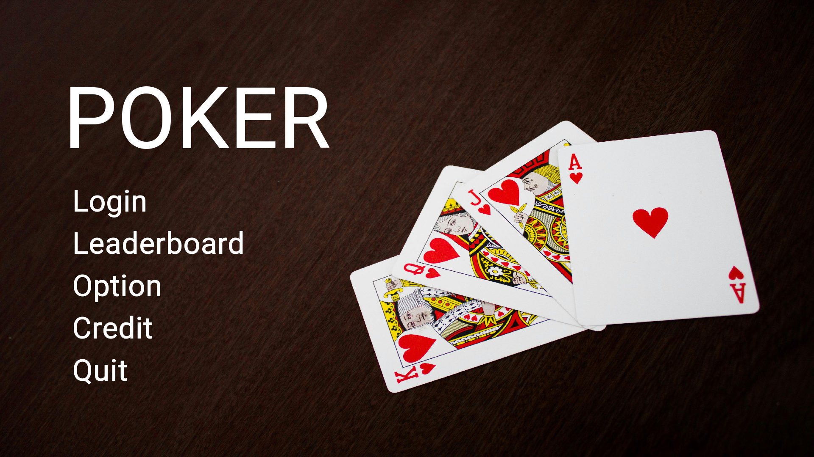
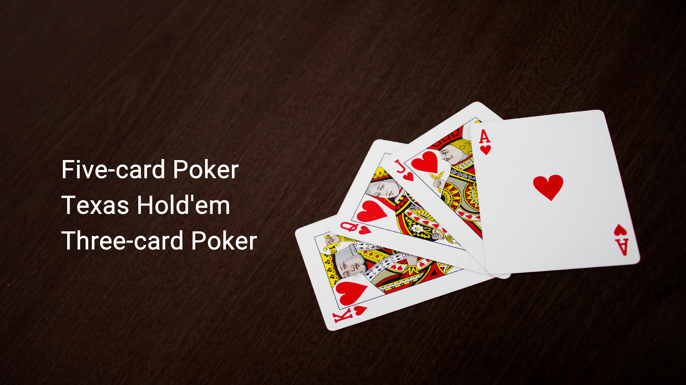
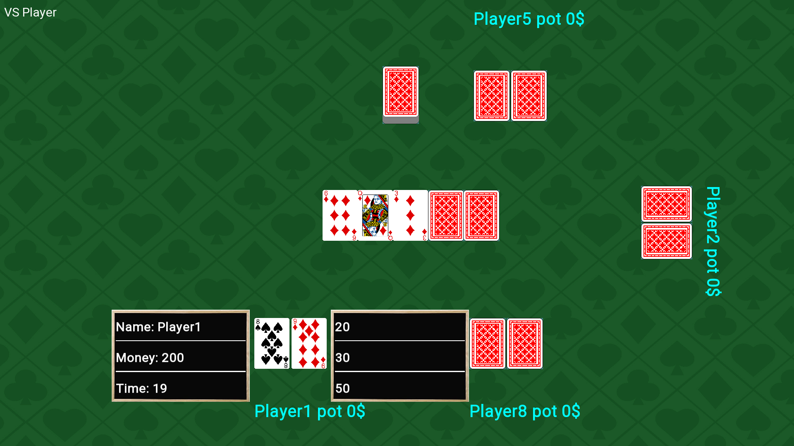
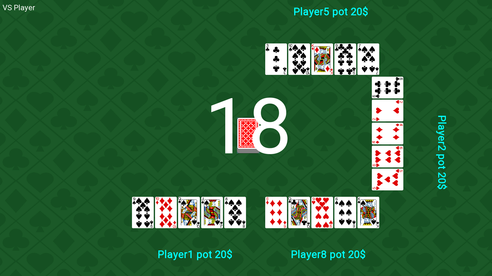
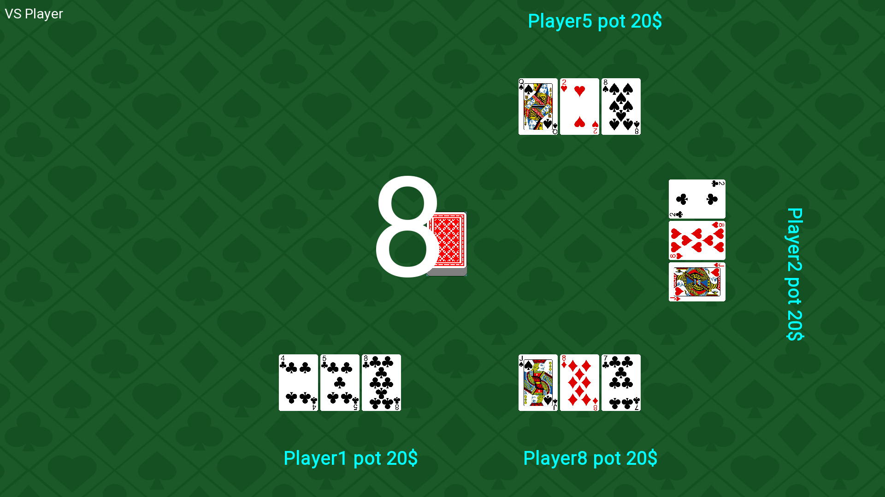
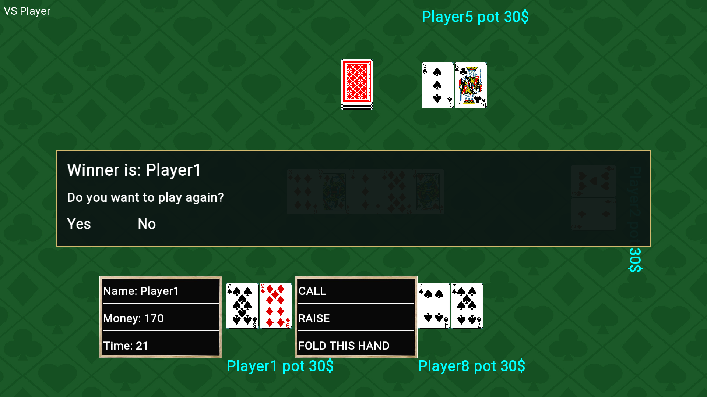

<div align="center">

# N13 Poker

**Game bài desktop C++/SFML với Texas Hold’em, Poker 5 lá và bài 3 lá.**

Chơi cùng bạn bè trên một máy hoặc thử sức với bot trong Texas Hold’em.

[](#công-nghệ-sử-dụng)
[](https://www.sfml-dev.org/)
[](#build-từ-mã-nguồn)
[](#chơi-ngay)

[Tải game](https://github.com/nhbl-ai/n13-poker/releases/latest) · [Tính năng](#tính-năng) · [Hình ảnh](#hình-ảnh-minh-họa) · [Build](#build-từ-mã-nguồn) · [Thành viên](#nhóm-phát-triển)



</div>

## Giới thiệu

N13 Poker là dự án game bài của nhóm N13, được thực hiện trong khuôn khổ môn học tại HCMUS. Game kết hợp xử lý bộ bài, đánh giá tay bài và xác định người thắng với giao diện đồ họa, hoạt ảnh chia bài và âm thanh.

Phiên bản hiện tại sử dụng **CMake + GCC/MinGW-w64** để build, có thể đóng gói thành ứng dụng Windows chạy độc lập. Người chơi mở file `.exe`, không cần cài Visual Studio.

Tiền cược hiển thị trong game là điểm mô phỏng, không có giao dịch tiền thật.

## Tính năng

| Chế độ | Chơi với người — PVP | Chơi với bot — PVE | Số người |
|---|:---:|:---:|:---:|
| Texas Hold’em | Có | Có | 2–6 |
| Poker 5 lá | Có | — | 2–6 |
| Bài 3 lá | Có | — | 2–6 |

- **Texas Hold’em:** bài riêng, bài chung, lựa chọn CALL / RAISE / FOLD và các mức tăng cược 20, 30, 50.
- **Đánh giá bài:** chọn bộ 5 lá tốt nhất trong 7 lá của Texas; nhận diện sảnh, thùng, cù lũ, tứ quý, sảnh thùng, royal flush và so lá phụ khi cần.
- **Đăng ký, đăng nhập cục bộ** và lưu bảng xếp hạng theo số trận thắng / số trận đã chơi.
- **Hoạt ảnh chia bài, lật bài, đếm thời gian**, nhạc nền và hiệu ứng nhấn chuột; có tùy chọn bật/tắt âm thanh.
- **Kết quả thắng hoặc hòa**, hiển thị đầy đủ người hòa và lựa chọn chơi lại / về menu.
- **Ghế Guest/Bot khi thiếu tài khoản:** có thể bắt đầu chơi với một tài khoản; các tên tạm không tạo thêm bản ghi người dùng.

PVP là chơi luân phiên trên **cùng một máy**, không phải chế độ multiplayer qua mạng.

## Hình ảnh minh họa

Ảnh dưới đây được chụp trực tiếp từ game bằng dữ liệu minh họa.

### Chọn loại game



### Texas Hold’em — bàn chơi và lựa chọn tăng cược



### Poker 5 lá



### Bài 3 lá



### Kết quả ván chơi



## Chơi ngay

1. Mở trang [Releases](https://github.com/nhbl-ai/n13-poker/releases/latest), tải gói **N13-Poker-1.1-Windows.zip**.
2. Giải nén **toàn bộ** gói vào thư mục có quyền ghi, chẳng hạn Documents.
3. Mở `N13Poker.exe`.
4. Lần đầu, vào **Login → Register** để tạo tài khoản, rồi đăng nhập và chọn game.

Giữ ảnh, font, âm thanh, `openal32.dll` và `resources.manifest` cùng thư mục với `.exe`. Máy chơi không cần Visual Studio, CMake hoặc GCC. Nền tảng đã kiểm thử: **Windows x64**.

## Công nghệ sử dụng

| Công nghệ | Vai trò |
|---|---|
| **C++17** | Logic bộ bài, đánh giá tay bài, quản lý ván chơi và giao diện |
| **SFML 2.6.2** | Cửa sổ, đồ họa 2D, font chữ, bàn phím/chuột và âm thanh |
| **CMake ≥ 3.24** | Cấu hình build và lấy SFML từ mã nguồn có SHA-256 cố định |
| **MinGW-w64 / GCC** | Biên dịch bản Windows độc lập Visual Studio |
| **CTest** | Chạy các kiểm thử tự động |
| **File văn bản** | Lưu tài khoản hiện tại và thống kê chơi cục bộ |

SFML và C++ runtime được liên kết tĩnh trong bản Windows; OpenAL được đóng kèm để phát âm thanh.

## Build từ mã nguồn

### Windows

Cần **MinGW-w64/GCC hỗ trợ C++17** và `mingw32-make`. Bản Windows hiện tại được kiểm thử với GCC 8.1.0.

```powershell
git clone https://github.com/nhbl-ai/n13-poker.git
cd n13-poker
.\build-windows.ps1
```

Hoặc nhấp đôi `build-windows.bat`. Nếu CMake chưa có trong PATH, script tải CMake portable 3.31.6 và kiểm tra SHA-256. Lần build đầu cần mạng để tải CMake/SFML.

Nếu các công cụ nằm ở vị trí khác:

```powershell
.\build-windows.ps1 `
  -CompilerBin 'C:\MinGW64\bin' `
  -CMakePath 'C:\Tools\CMake\bin\cmake.exe'
```

Script cấu hình, build Release, chạy kiểm thử rồi tạo `dist\N13Poker.exe`.

### Lệnh CMake tương đương

Khi CMake và MinGW-w64 đã có trong PATH:

```powershell
cmake -S . -B build -G 'MinGW Makefiles' -DCMAKE_BUILD_TYPE=Release
cmake --build build --parallel 4
ctest --test-dir build --output-on-failure
cmake --install build --prefix "$PWD/dist" --component Game
```

## Dữ liệu cục bộ

Game tạo các file sau cạnh `.exe`:

| File | Nội dung |
|---|---|
| `users.txt` | Tài khoản cục bộ |
| `player.txt` | Người đang đăng nhập |
| `Leaderboard.txt` | Số trận thắng và số trận tham gia |

Repo chỉ chứa **mẫu dữ liệu rỗng** trong `data/defaults/`. Các file dữ liệu thật được loại khỏi Git; build/cài lại không ghi đè dữ liệu đã tồn tại. Khi nâng cấp bản portable, sao lưu ba file trên trước khi thay game.

Đây là hệ thống tài khoản demo lưu trên máy: hãy dùng mật khẩu riêng cho game, không dùng lại mật khẩu của dịch vụ khác.

## Cấu trúc project

```text
N13/                 Mã C++ và tài nguyên hình ảnh, font, âm thanh
  PokerHand.*        Bộ đánh giá tay bài 5 lá / 7 lá
  LogicGame.*        Logic Texas Hold’em
  LogicFiveCards.*   Logic Poker 5 lá
  LogicThreeCards.*  Logic bài 3 lá
  WinnerResult.h     Kết quả thắng / hòa có kích thước cố định
cmake/               Đóng gói tài nguyên và dữ liệu mặc định
data/defaults/       Mẫu dữ liệu rỗng
docs/images/         Ảnh chụp giao diện game
licenses/            Thông báo giấy phép thư viện bên thứ ba
tests/               Kiểm thử tự động
CMakeLists.txt       Cấu hình build
build-windows.ps1    Build, kiểm thử và đóng gói trên Windows
```

## Kiểm thử

- **4 kiểm thử CTest:** regression logic, các lỗi biên/bộ nhớ, phân hạng toàn bộ tay bài và tài nguyên đóng gói.
- **2.598.960 tay bài 5 lá:** duyệt toàn bộ tổ hợp và đối chiếu số lượng từng phân hạng bằng phép đếm tổ hợp độc lập.
- **75 kịch bản UI:** PVP/PVE 2–6 người, CALL/RAISE/FOLD, hết giờ, hòa, chơi lại, đóng cửa sổ, ít tài khoản và lưu thống kê.

Xem [VERIFICATION.md](VERIFICATION.md) và [FIXES.md](FIXES.md) để biết phạm vi kiểm thử, các bản sửa và giới hạn đã ghi nhận.

## Nhóm phát triển

Các thành viên được ghi nhận trong [credits gốc của project](N13/credits.txt):

| Thành viên |
|---|
| **Nguyen Gia** |
| **Nguyen Hoang Bao Long** |
| **Vo My Ngoc** |

## Thư viện và tài nguyên bên thứ ba

Game sử dụng SFML, OpenAL cùng các thư viện và tài nguyên đi kèm. Thông báo giấy phép được giữ trong [THIRD_PARTY_NOTICES.md](THIRD_PARTY_NOTICES.md) và thư mục [licenses/](licenses/). Quyền sử dụng tài nguyên đồ họa, font và âm thanh tuân theo điều khoản của chủ sở hữu tương ứng.
